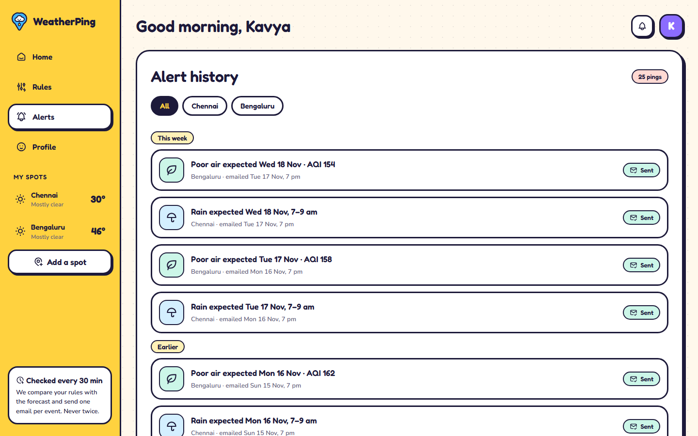
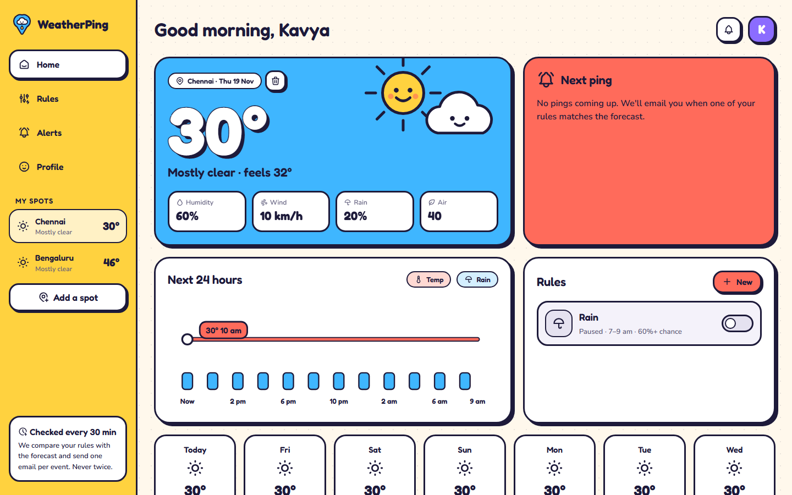

# WeatherPing

[](https://github.com/Pavithiran21/WeatherPing/actions/workflows/ci.yml)

**Live demo: [weather-ping.vercel.app](https://weather-ping.vercel.app)** (the Log in page has a one-click demo account). It runs on free hosting, so the first load after a quiet spell can take about a minute, and the forecast and alert emails have limits there (see [Deploy](#deploy)).

Hyperlocal weather alerts by email. You save the places you care about, describe the weather that matters to you ("rain over 60 % between 7 and 9 am at home"), and WeatherPing emails you once when the forecast says it will happen. You don't need to open a weather app every morning.

**Node 26 · Express 5 · MongoDB (Mongoose) · React 19 · TanStack Query · Tailwind CSS 4 · Playwright**

**What's hard here**

- **One email per rule per event, even when evaluator runs overlap.** The alert event is inserted before the email is sent, under a unique index on `(ruleId, eventKey)`, so only one insert can ever win ([alertEvent.model.js](backend/src/modules/alerts/alertEvent.model.js), [evaluator.service.js](backend/src/modules/evaluator/evaluator.service.js)).
- **No alert is ever sent from bad data.** Every weather call has a timeout and one retry; if it still fails, that place is skipped for the run and counted, and nothing is emailed ([openMeteo.client.js](backend/src/modules/weather/openMeteo.client.js)).
- **"7 to 9 am" means the user's own 7 to 9 am.** Windows and event dates are worked out in each user's time zone, and the worst hour in the window decides ([timeWindow.js](backend/src/modules/evaluator/timeWindow.js), [ruleMatcher.js](backend/src/modules/evaluator/ruleMatcher.js)).
- **A one-click unsubscribe link that can't be forged.** The link carries the rule id and an HMAC of it; nothing is stored, and an edited link is refused ([unsubscribeToken.js](backend/src/modules/unsubscribe/unsubscribeToken.js)).

| Alert history | Dashboard |
|---|---|
|  |  |

## Signature feature: one email per event, even when runs overlap

A scheduled evaluator checks every active rule against the forecast. It is built so that a user gets **exactly one email per rule per event**, no matter how often the job runs or whether two runs overlap.

- **Claim before send.** Before an email goes out, the evaluator inserts an `AlertEvent` for that rule and window. A **unique index on `(ruleId, eventKey)`** (`eventKey` is the window's local date in the user's time zone) means only one insert can ever succeed. The run that wins sends the email. Every other run gets MongoDB's duplicate-key error (E11000) and counts it as a skipped duplicate. No lock or leader election is needed. See `backend/src/modules/alerts/alertEvent.model.js` and `evaluateRule` in `backend/src/modules/evaluator/evaluator.service.js`.
- **At-most-once delivery.** A failed send is marked `failed` and never retried, because a retry could duplicate a mail the SMTP server had in fact accepted.
- **No alert from bad data.** Each place's forecast is fetched once per run and cached for that run. Every call has a timeout (`WEATHER_TIMEOUT_MS`) and one retry after 500 ms for timeouts and 5xx errors. If the API still fails, that place is skipped for the run and counted. See `backend/src/modules/weather/openMeteo.client.js`.
- **Run log without personal data.** Each run writes a `JobRun` record and one log line with counts only: rules checked, alerts sent, duplicates skipped, places skipped and email failures.

The job runs in-process with node-cron (`EVALUATOR_CRON`, every 30 minutes by default). On a free host that sleeps, an external cron can call `POST /api/internal/jobs/evaluate` with the `X-Job-Secret` header instead.

## Features

- Register, log in, profile with time zone, password reset by email, delete my account
- Saved places found by search (Open-Meteo geocoding) or coordinates
- Alert rules per place: rain, heat above, cold below, wind above, air quality (AQI), each with a threshold and a daily time window
- Pause, resume and delete rules; alert history with unread markers
- Every alert email has a signed one-click unsubscribe link
- Paginated lists and one JSON error format (`{ error: { code, message, details, requestId } }`) across the API

## Roles

One role, **User**. Each user sees and changes only their own places, rules and alerts. Every query is scoped to the logged-in user, and another user's record answers 404.

## Tech stack

| Layer | Choice |
|-------|--------|
| Backend | Node 26, Express 5, Mongoose 9 (MongoDB Atlas), Zod 4, jsonwebtoken, bcryptjs, node-cron, Nodemailer, pino, helmet, express-rate-limit, Luxon |
| Frontend | React 19, Vite 8, React Router 8, TanStack Query 5, React Hook Form + Zod, Tailwind CSS 4, Tabler icons |
| Weather data | Open-Meteo forecast, air-quality and geocoding APIs (free, no key) |
| Email | Any SMTP server: Ethereal for development, Brevo for real mail |

Plain JavaScript everywhere: CommonJS in the backend, ES modules in the frontend.

## Project structure

```
backend/
  src/
    config/env.js          validated environment (Zod)
    middleware/            auth, rate limits, job secret, central error handler
    modules/
      auth/ users/         login, refresh-token rotation, password reset, profile
      locations/ rules/    places and alert rules (controller → service → repository)
      evaluator/           scheduled job: rule matching, time windows, run cache, job runs
      alerts/              alert events (the dedupe guard) and history
      mail/ unsubscribe/   email templates, sending, signed unsubscribe links
      weather/             Open-Meteo client with timeout and retry
  scripts/                 seed:dev, seed:demo, seed:e2e, make-env, job:evaluate, ethereal:new
e2e/                       Playwright API, browser and evaluator tests, and the Open-Meteo stub
frontend/
  src/  api/ auth/ features/ (alerts, auth, dashboard, places, profile, rules, unsubscribe)
        components/ layout/ hooks/ lib/ pages/ toast/
```

## Run locally

**You need** Node 26.12 or later and a MongoDB Atlas free (M0) cluster. For email, any SMTP inbox works; a free [Ethereal](https://ethereal.email) account is easiest.

Create `backend/.env` with these variables:

| Variable | What it is |
|----------|------------|
| `NODE_ENV` | `development`, `test` or `production` |
| `PORT` | API port (4000) |
| `LOG_LEVEL` | pino log level (`info`) |
| `MONGODB_URI` | Atlas connection string, database `weatherping` |
| `JWT_SECRET` | Signs access tokens (at least 32 characters) |
| `UNSUBSCRIBE_SECRET` | Signs unsubscribe links (at least 32 characters) |
| `JOB_TRIGGER_SECRET` | `X-Job-Secret` value for the internal job endpoint (at least 32 characters) |
| `FRONTEND_URL` | `http://localhost:5173`, used in email links |
| `SMTP_HOST`, `SMTP_PORT`, `SMTP_USER`, `SMTP_PASS`, `SMTP_FROM` | Outgoing mail |
| `OPEN_METEO_FORECAST_URL`, `OPEN_METEO_AIR_QUALITY_URL`, `OPEN_METEO_GEOCODING_URL` | Weather API base URLs, which can point at a mock server |
| `WEATHER_TIMEOUT_MS` | Timeout for one weather call (5000) |
| `EVALUATOR_CRON` | Evaluator schedule (`*/30 * * * *`) |
| `DEMO_MODE` | `true` shows the demo log-in on the Log in page |
| `DEMO_PASSWORD` | Password given to the seeded dev and demo accounts |
| `DEMO_SMTP_HOST`, `DEMO_SMTP_PORT`, `DEMO_SMTP_USER`, `DEMO_SMTP_PASS`, `DEMO_SMTP_FROM` | Inbox for mail to `@demo.weatherping.test` addresses, so demo mail never goes to a real server |
| `TRUST_PROXY` | `loopback` (default) or the number of proxies in front of the API (`1` on Render), so rate limits see the visitor's IP |
| `STATIC_DIR` | A folder with the built frontend. When set, the API also serves the app, so one service is the whole site (the Docker image sets it) |

Then:

```powershell
cd backend
npm ci
npm run seed:dev        # dev@weatherping.test with places, rules and 24 past alerts
npm run seed:demo       # demo accounts (see below)
npm run dev             # API on http://localhost:4000

cd ../frontend
npm ci
npm run dev             # app on http://localhost:5173 (Vite proxies /api to 4000)
```

Run the evaluator once by hand with `npm run job:evaluate` in `backend/`. `npm run ethereal:new` creates a fresh Ethereal inbox and writes it into `.env`.

### Or with Docker

```powershell
docker compose up --build
docker compose exec app npm run seed:demo
# then open http://localhost:4000 and choose "Log in as User"
```

## Demo accounts

With `DEMO_MODE=true`, the Log in page offers **Log in as User**. Every seeded account uses the password you set in `DEMO_PASSWORD`.

| Role | Email | What to try |
|------|-------|-------------|
| User | `user@demo.weatherping.test` | Add a place by search, create a rain rule for tomorrow morning, pause and resume it, open Alert history. Blocked: opening another user's rule by its id gives "not found". |

Demo accounts cannot change their email or password or delete themselves.

## Testing

**Playwright only**, in [`e2e/`](e2e): API tests with Playwright's `request` client, browser tests, and evaluator tests, against a real MongoDB (`weatherping_test`) and real Ethereal inboxes. CI runs them on every push.

- **54 tests**: 34 API, 10 browser and 10 evaluator.
- **No internet, no quota:** Open-Meteo is replaced by [`e2e/mocks/open-meteo-stub.js`](e2e/mocks/open-meteo-stub.js), which answers geocoding, forecast and air-quality requests with fixed weather chosen by the place's latitude (rainy, dry, hot, cold, windy, smoggy), and can be made to fail (HTTP 503), answer slowly, return broken JSON or the wrong shape.
- **Exactly once:** the evaluator is run three times and then three at once for a rule, and the user gets two alerts (today's and tomorrow's date) and two emails; five runs started at once for a brand-new rule send exactly two emails between them.
- **Every condition:** rain, heat, cold, wind and air quality alert when the forecast reaches the threshold (inclusive) and stay quiet when it is one step short; a paused rule alerts nothing until it is resumed.
- **Bad weather data:** a service that is down, slow, broken or odd sends nothing, is counted in the run summary, and does not stop the other places. A place is asked about once per run however many rules and users share it, and only for what its rules need.
- **Time zones:** a user in Auckland gets alerts for Auckland's today and tomorrow.
- **The unsubscribe link:** the link read from the real email pauses exactly that rule without a log-in and Undo turns it back on; a link with another rule's id, a cut signature or garbage is refused, and a deleted rule is a 404.
- **Rules and access:** each condition has its own range (inclusive at both ends), a window must end after it starts, a patch is checked as a whole, and another user's place, rule and alerts answer 404 and never show.
- **Accounts and email:** a refresh token works once, the reset link is read from the real inbox and works once, demo accounts can't change their password or be deleted, and mail for a demo address goes to the demo inbox and never to the main one.
- **In the browser:** the redirect back to the page asked for, sign-up, the demo panel, adding a spot by search and by coordinates, creating, pausing, resuming and deleting a rule, the alert history with its filter and unread badge, and the unsubscribe page.

The evaluator tests run last and one at a time, because an evaluator run checks every active rule in the database. Every assertion is about the test's own user, and each test picks its own place by giving it a unique latitude.

```powershell
cd e2e
npm ci
npx playwright install chromium
npm test        # writes .env.test, resets and seeds weatherping_test, starts the stub, the API and the app on their own ports, runs everything
```

## Deploy

The frontend runs on [Vercel](https://vercel.com) and the API on [Render](https://render.com), and the browser still sees one origin: [`frontend/vercel.json`](frontend/vercel.json) forwards `/api/*` to the Render service, so the cookies (SameSite=Strict) work with no CORS or cross-site cookies.

- **Frontend (Vercel):** import the repository, set the Root Directory to `frontend` (framework Vite, build `npm run build`, output `dist`). `vercel.json` also sends every other path to `index.html` for React Router and sets the page's security headers. If the Render service is renamed, change its URL in `vercel.json`.
- **API (Render):** one free web service from `Dockerfile.api` (see [`render.yaml`](render.yaml)). The full `Dockerfile` (API plus built frontend on one origin) is what `docker-compose.yml` and CI use.

- **Database:** MongoDB Atlas free (M0) with a `weatherping_demo` database; allow Render's outbound IPs (or 0.0.0.0/0) under Network Access.
- **Settings:** `NODE_ENV=production`, `TRUST_PROXY=2` (Vercel, then Render's proxy), `DEMO_MODE=true`, `DEMO_PASSWORD`, `FRONTEND_URL` = the Vercel URL, the three `OPEN_METEO_*_URL` values, and SMTP for real mail (Brevo) plus `DEMO_SMTP_*` (Ethereal) for the demo accounts' mail.
- **Demo data:** free Render services have no Shell, so run `npm run seed:demo` once from your own machine (in `backend/`), with `ENV_FILE` pointing at an env file whose `MONGODB_URI` ends in `/weatherping_demo`.
- **Alerts on a free plan:** a sleeping service runs no jobs, so point an external cron (for example cron-job.org, every 30 minutes) at `POST /api/internal/jobs/evaluate` with the `X-Job-Secret` header.

Free services sleep after 15 minutes without traffic, so the first visit after that takes about a minute. Free Render also blocks outbound SMTP (ports 25, 465 and 587), so the live demo sends no alert email; places, rules and the alert list work, and emails are sent when you run WeatherPing locally or on a paid instance.

**Forecast on free hosting:** Open-Meteo's free API answers the shared address that free Render uses with HTTP 429, so the live demo reaches it through a small free Cloudflare Worker, [`docs/cloudflare-relay.js`](docs/cloudflare-relay.js). Set `OPEN_METEO_FORECAST_URL` and `OPEN_METEO_AIR_QUALITY_URL` to `https://<your-worker>.workers.dev/<secret>/forecast` and `.../<secret>/air-quality`; the Worker forwards only those two paths, only for GET and only when the secret matches, and caches each answer for 10 minutes. On a host that Open-Meteo accepts (your own machine, a paid instance), the default Open-Meteo addresses work as they are. Without either, the page shows a clear "weather service unavailable" message with Try again, and everything else still works.

## Demo videos

- `WeatherPing-full-workflow.webm`: sign-up, a place and a rain rule, the evaluator run three times and then twice at once with one email per event, password reset, and the unsubscribe link (including an edited link that is refused)
- `WeatherPing-user-demo.webm`: the User role walkthrough

<!-- To embed: edit this README on GitHub and drag the .webm files from the workspace videos/ folder here. -->

## License

Copyright (c) 2026 R.Pavithiran. All rights reserved. The source is public so you can read it and see how it is built. Please ask before copying, reusing or redistributing it.
